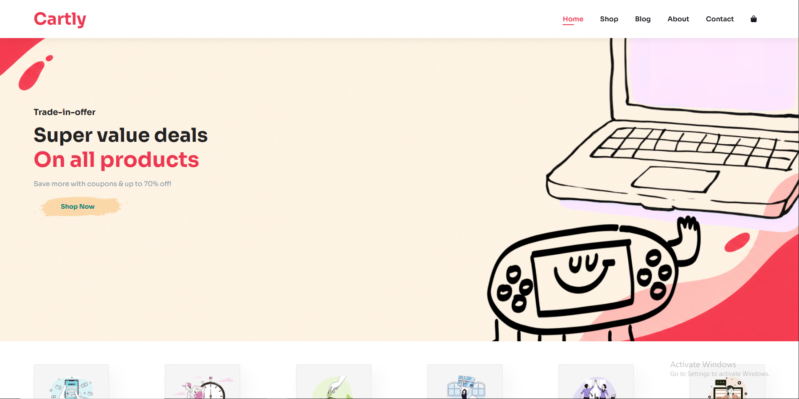
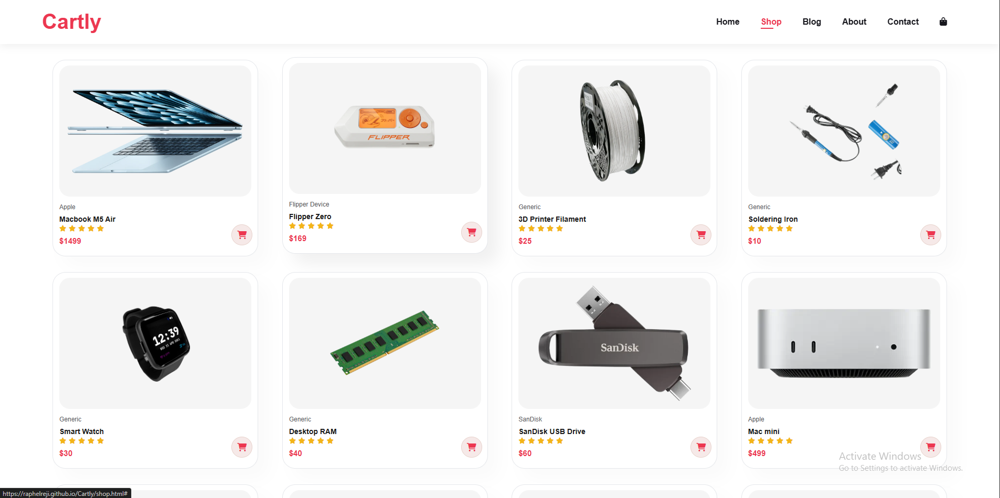
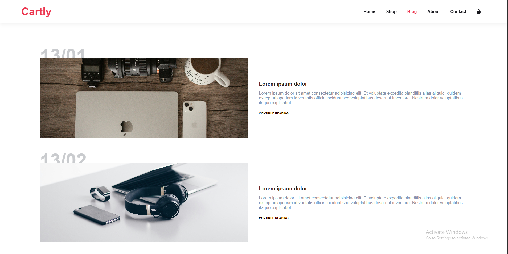
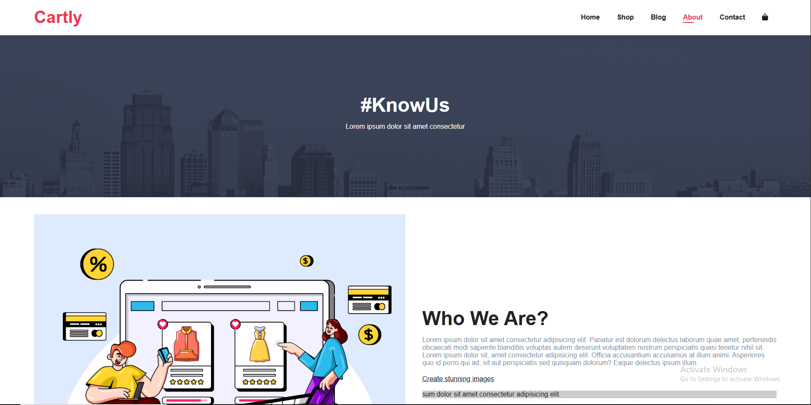
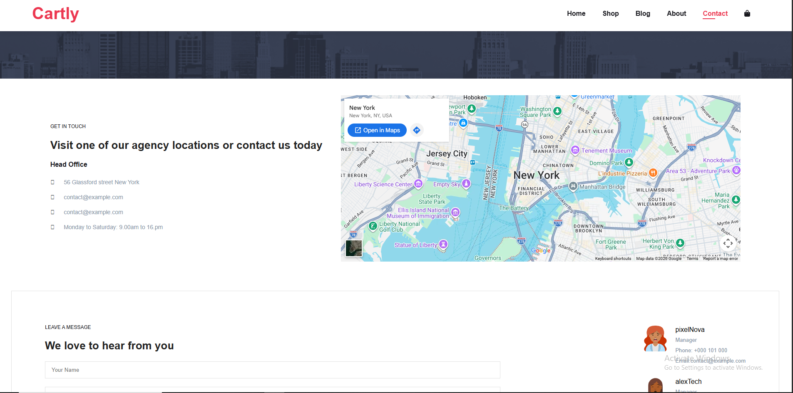
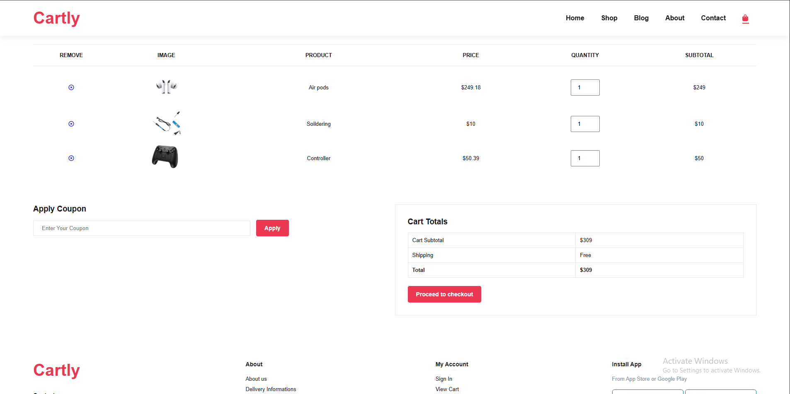

# Cartly

### A Responsive Tech-Themed E-Commerce Website

Cartly is an e-commerce responsive website created using HTML, CSS, and a little bit of JavaScript.

This website was created for learning new things and exploring web development. It was so cool to complete this awesome project, and I really enjoyed seeing the finished result!

## Live Demo

[View Cartly Live](https://raphelreji.github.io/Cartly/)

## About the Project

Cartly is a tech-themed shop with a collection of technology products. The entire website is responsive, so you can view it on mobile phones, big screens, iPads, and other devices.

It has six main pages:

- Home Page
- Shop Page
- Blog Page
- About Page
- Contact Page
- Cart Page

## Screenshots

## Product Page

In the Shop page, you can see different technology products. When you click on the MacBook Air product, you will be taken to a dedicated product page created specifically for the MacBook Air.

## Responsive Design

The whole website is responsive.

- Works on mobile devices.
- Works on tablets and iPads.
- Works on laptops.
- Works on big screens.

The product images and all the product cards are also responsive.

## Technologies Used

- HTML
- CSS
- A little bit of JavaScript

## Credits

Special thanks to **Tech2Tech** for the tutorial that helped me build the website structure.

The images used in this project belong to their respective rightful owners.

## Disclaimer

- The product prices shown on this website are not real.
- The images belong to their respective owners.
- Cartly is a learning project, not a real online store.

---

**It was so cool to complete this awesome project!**
